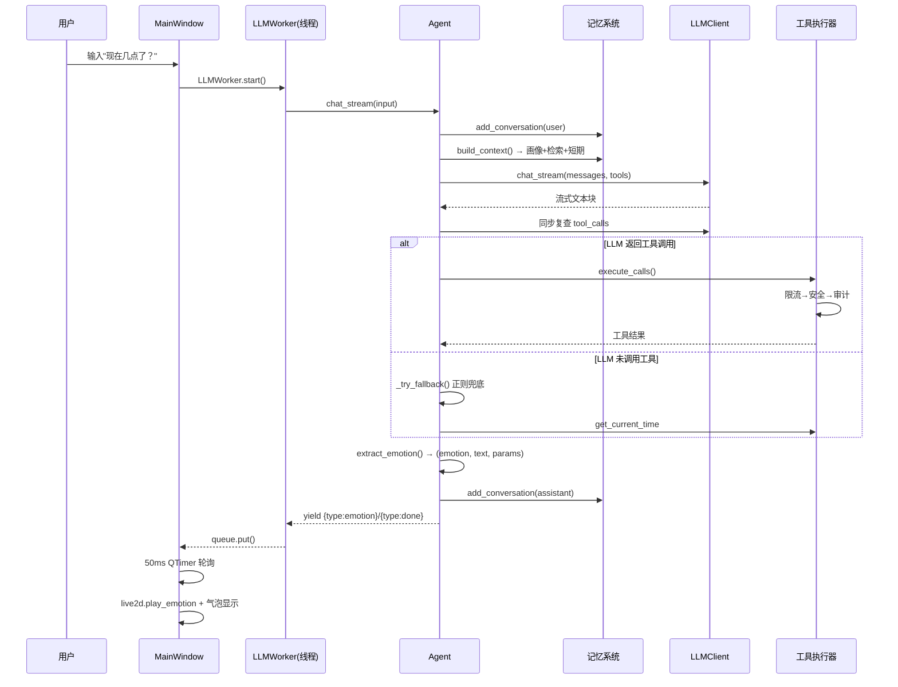

# 子衿开发者手册（DEVELOPER.md）

> 面向即将接手本项目的开发者。目标：**读完即可上手开发**。
> 配套解剖文档：[docs/1-项目概览.md](1-项目概览.md) · [docs/2-架构与模块详解.md](2-架构与模块详解.md) · [docs/3-核心逻辑与扩展指南.md](3-核心逻辑与扩展指南.md)

---

## 一、5 分钟快速开始

### 1.1 环境要求

| 依赖 | 要求 | 说明 |
|------|------|------|
| Python | 3.11+ | 使用了 `str \| None` 等新语法 |
| 操作系统 | Windows（主） | Live2D SDK 与 DPI 设置为 Windows 优先 |
| 大模型 | Ollama（推荐本地）或 OpenAI API Key | 二选一 |
| 显卡 | 支持 OpenGL 3.3+ | Live2D 渲染必需 |

### 1.2 安装依赖

```bash
pip install -r requirements.txt
```

> 关键依赖：PyQt6、live2d（Cubism SDK）、chromadb、ollama、pyttsx3、pycaw。若 `live2d` 安装失败，见[排障 5.3](#53-live2d-包安装失败)。

### 1.3 准备大模型（二选一）

```powershell
# 方式 A：Ollama（推荐，本地免费）
# 1. 官网安装 Ollama
# 2. 拉取模型
ollama pull qwen2.5:7b-instruct
# 3. 默认配置即生效（http://localhost:11434）
```

```powershell
# 方式 B：OpenAI
set LLM_PROVIDER=openai_api
set OPENAI_API_KEY=sk-你的密钥
```

### 1.4 启动

```bash
python main.py
```

### 1.5 验证运行正常（5 个检查点）

| 检查点 | 预期结果 |
|--------|----------|
| 终端日志 | `=== 子衿桌面伴生代理 启动中 ===` → `Agent就绪: qwen2.5:7b-instruct` → `已注册工具: [26个工具]` → `子衿已上线` |
| 桌面 | 屏幕中央出现半透明悬浮窗，Live2D 角色"子衿"可见 |
| 双击窗口 | 弹出输入框与状态栏 |
| 输入"现在几点了？" | 气泡显示真实时间（走工具调用） |
| 右键窗口 | 出现圆环菜单（对话/备忘录/待办/记忆/设置/退出） |

> 无 Live2D 时（模型缺失）应用会降级运行，仅无角色画面，其余功能正常。

---

## 二、架构图解

### 2.1 总体架构（Mermaid）

```mermaid
graph TD
    subgraph 入口层
        MAIN[main.py<br/>配置校验→Agent→QApplication→MainWindow]
    end

    subgraph 协调层
        AGENT[core/agent.py<br/>Agent 协调器<br/>工具循环≤3轮+正则兜底]
        TEXEC[core/tool_executor.py<br/>限流→确认→安全→执行→审计]
        EMOTION[core/emotion.py<br/>[情感,body:x=y] 解析]
    end

    subgraph 能力层
        LLM[core/llm.py<br/>Ollama / OpenAI 双后端]
        MEM[core/memory/<br/>三层记忆]
        REG[tools/registry.py 注册表]
        TOOLS[tools/*.py 26个工具]
        SAFETY[tools/safety.py]
        AUDIT[tools/audit.py]
    end

    subgraph UI层
        WIN[ui/main_window.py]
        L2D[Live2DWidget]
        WORKER[LLMWorker 后台线程]
    end

    subgraph 事件层
        BUS[core/bus.py EventBus]
    end

    MAIN --> AGENT
    AGENT --> LLM
    AGENT --> MEM
    AGENT --> TEXEC
    AGENT --> EMOTION
    TEXEC --> REG --> TOOLS
    TEXEC --> SAFETY
    TEXEC --> AUDIT
    WIN --> L2D
    WIN --> WORKER
    WORKER --> AGENT
    AGENT -.事件.-> BUS
    TOOLS -.事件(tts_start/end).-> BUS
    BUS -.通知.-> WIN
```

### 2.2 一次对话的完整时序



---

## 三、目录结构圣经

```
ZiJin/
├── main.py                  ★ 唯一入口：配置校验→Agent→PyQt6主窗口→事件循环
├── build.py                 打包脚本：python build.py → PyInstaller
├── ZiJin.spec               PyInstaller 规格文件
├── version.py               版本号（当前 0.1.0），发版时改这里
├── pyproject.toml           pytest 配置（testpaths=["tests"]）
├── requirements.txt         依赖清单
│
├── config/
│   └── settings.py          ★ 唯一配置中心：全部常量/环境变量/人格提示词/validate()
│
├── core/                    ★ 纯业务层（严禁 import ui/）
│   ├── agent.py             ★ 协调器：chat/chat_stream/FALLBACK_RULES/工具循环
│   ├── llm.py               LLM 门面：Ollama + OpenAI 双后端适配
│   ├── emotion.py           情感/肢体参数解析协议 [emotion,body:k=v]
│   ├── tool_executor.py     工具五关流水线（限流/确认/安全/执行/审计）
│   ├── bus.py               事件总线（发布-订阅）
│   ├── chat_history.py      聊天记录持久化（data/chat_history.json）
│   ├── rate_limit.py        工具频率限制
│   ├── async_executor.py    耗时工具异步线程池
│   ├── log.py               日志封装（get_logger）
│   └── memory/              ★ 三层记忆子系统
│       ├── manager.py       ★ 统一入口（add_conversation/build_context）
│       ├── short_memory.py  短期：内存列表，上限 max_rounds*2 条
│       ├── long_memory.py   长期：ChromaDB 向量检索（去重/批量/缓存/线程安全）
│       ├── user_profile.py  用户画像：data/user_profile.json
│       ├── importance.py    重要性打分（决定是否入长期库）
│       └── viewer.py        记忆查看器（供 UI 展示）
│
├── tools/                   ★ 工具系统
│   ├── registry.py          ★ 注册表：@registry.register 装饰器 + LLM定义生成
│   ├── safety.py            安全校验：危险命令拦截/路径白名单/参数范围
│   ├── audit.py             审计：data/audit.jsonl，超10MB轮转
│   ├── __init__.py          ★ 关键！所有工具模块在此 import 才会注册
│   ├── clock.py             时间/日期/时间戳（safe）
│   ├── memo.py              备忘录 CRUD（data/memo.json）
│   ├── todo.py              待办 CRUD（data/todo.json）
│   ├── volume.py            音量控制（pycaw）
│   ├── tts.py               TTS 朗读（pyttsx3）+ 口型同步事件
│   └── pc_manager.py        系统信息/开关应用/输入/剪贴板/搜索/提醒
│
├── ui/                      ★ 界面层（单向依赖 core/）
│   ├── main_window.py       ★ 主窗口：透明悬浮窗/托盘/事件分发/调试快捷键
│   ├── components/          ★ 可复用控件
│   │   ├── live2d_widget.py ★ Live2D 渲染/交互/情感预设（10种）/口型
│   │   ├── chat_bubble.py   聊天气泡
│   │   ├── radial_menu.py   圆环菜单（6项，ITEMS 常量可扩展）
│   │   ├── status_bar.py    状态栏
│   │   └── base_widget.py   浮动窗基类
│   ├── widgets/             功能面板：memo/todo/memory/audit/settings
│   └── workers/
│       └── llm_worker.py    后台线程 + queue 通信，UI 不阻塞
│
├── models/                  ★ Live2D 模型资源（Hiyori 角色，只读）
├── docs/                    开发文档（本系列 1/2/3 在此）
├── data/                    运行时数据（ChromaDB/画像/备忘/待办/聊天记录/审计，gitignore）
└── tests/                   pytest 测试（注意：与代码存在不同步问题，见排障 5.5）
```

---

## 四、常见开发任务

### 4.1 添加一个新工具

```python
# tools/weather.py —— 新建文件
from tools.registry import registry

@registry.register(
    name="get_weather",
    description="查询指定城市的天气情况",
    parameters={
        "type": "object",
        "properties": {
            "city": {"type": "string", "description": "城市名"},
        },
        "required": ["city"],
    },
    safety_level="safe",          # safe / moderate / dangerous
    required_confirm=False,       # dangerous 工具建议 True
)
def get_weather(city: str) -> str:
    """工具实现：返回字符串会作为结果回填给 LLM"""
    return f"{city} 今天晴，25℃"
```

```python
# tools/__init__.py —— 追加一行（关键，否则不生效）
import tools.weather
```

重启应用，启动日志 `已注册工具` 应包含 `get_weather`。可在 [core/agent.py](core/agent.py) 的 `FALLBACK_RULES` 加正则兜底，详见 [3-核心逻辑与扩展指南.md](3-核心逻辑与扩展指南.md)。

### 4.2 添加一个新数据文件（相当于"加一张表"）

本项目无 SQL 数据库，持久化采用 **JSON 文件**（参考 [tools/memo.py](tools/memo.py)）：

```python
# tools/notes.py
import json
import os
from datetime import datetime
from config.settings import DATA_DIR  # 统一的数据目录常量
from tools.registry import registry

NOTES_PATH = os.path.join(DATA_DIR, "notes.json")

def _load() -> list[dict]:
    """读文件，不存在返回空列表"""
    if os.path.exists(NOTES_PATH):
        with open(NOTES_PATH, "r", encoding="utf-8") as f:
            return json.load(f)
    return []

def _save(notes: list[dict]):
    """写文件（先建目录再写）"""
    os.makedirs(os.path.dirname(NOTES_PATH), exist_ok=True)
    with open(NOTES_PATH, "w", encoding="utf-8") as f:
        json.dump(notes, f, ensure_ascii=False, indent=2)

@registry.register(
    description="添加一条笔记",
    parameters={"type": "object",
                "properties": {"content": {"type": "string"}},
                "required": ["content"]},
    safety_level="safe",
)
def add_note(content: str) -> str:
    notes = _load()
    notes.append({"id": len(notes) + 1, "content": content,
                  "created_at": datetime.now().isoformat()})
    _save(notes)
    return f"已记录：{content}"
```

需要**向量检索**的数据（要"记住并能回忆"）则存入 ChromaDB，走 `MemoryManager` 扩展，不要自己新开向量库。

### 4.3 写单元测试

测试放 `tests/`，`pytest` 自动发现（[pyproject.toml](pyproject.toml)）。参考现有风格：

```python
# tests/test_weather.py
import sys
import os
sys.path.insert(0, os.path.dirname(os.path.dirname(os.path.abspath(__file__))))

from tools.weather import get_weather


def test_get_weather_returns_text():
    result = get_weather("北京")
    assert "北京" in result
```

```bash
# 运行全部测试
pytest
# 运行单个文件
pytest tests/test_weather.py -v
```

✅ 兼容性已处理：`tests/test_emotion.py`、`tests/test_all.py` 的解包已与 [core/emotion.py](core/emotion.py) 三元组返回值对齐（`emotion, text, _ = extract_emotion(...)`），并修复了文本前导空格导致的标签切片偏移 bug。

### 4.4 新增情感表情

需联动修改 4 处（遗漏任一都不完整）：
1. [config/settings.py](config/settings.py#L29) `EMOTION_TAGS` 加标签
2. [config/settings.py](config/settings.py#L45-L56) `EMOTION_MOTIONS` 加映射
3. [ui/components/live2d_widget.py](ui/components/live2d_widget.py#L228-L313) `presets` 加动作+参数预设
4. （可选）[core/emotion.py](core/emotion.py#L18-L25) 加肢体参数映射

### 4.5 接入新 LLM 提供商

在 [core/llm.py](core/llm.py) 的 `chat()/chat_stream()` 加分流分支，实现 `_chat_xxx()`，遵守统一契约：
- 同步返回 `{"content": str, "tool_calls": [...]?}`
- 流式 yield `{"content": str, "done": bool}`

同时更新 `config/settings.py` 配置与 `validate()` 白名单。

### 4.6 打包发布

```bash
python build.py        # 先清空 build/dist → PyInstaller → 输出 dist/ZiJin/
```

发布前改 [version.py](version.py) 的 `__version__` 并打 tag。

### 4.7 UI 调试快捷键

运行中直接按键（[main_window.py](ui/main_window.py#L374-L432)）：
| 按键 | 作用 | 按键 | 作用 |
|------|------|------|------|
| Q~P | 10 种情感动画 | 1~6 | 6 种基础动作 |
| L | 口型同步测试 | H | 帮助 | 
| 0 | 重置模型参数 | | |

---

## 五、排障急救指南

### 5.1 启动报 `配置验证失败`

```
ValueError: 配置验证失败: ...
```
- 原因：`LLM_PROVIDER` 不是 `ollama/openai_api`，或选了 `openai_api` 但没设密钥。
- 修复：检查环境变量，或在 `config/settings.py` 顶部确认默认值。校验逻辑见 [settings.py](config/settings.py#L131-L141)。

### 5.2 启动无角色画面（Live2D 不显示）

- 看启动日志是否出现：`未找到Live2D模型文件，Live2D功能将不可用`
- 原因：`models/Hiyori.model3.json` 缺失。
- 修复：恢复模型文件；或检查显卡 OpenGL 是否支持 3.3（更新驱动）。

### 5.3 `live2d` 包安装失败

- 常见于 Python 版本/架构不匹配。live2d Python SDK 依赖官方 Cubism Core。
- 尝试：确认 Python 3.11+ 与 64 位；`pip install live2d` 失败时查看错误（需手动放置 Cubism Core 动态库）。
- 兜底：删除 `live2d` 依赖后应用仍可运行（仅无角色渲染），UI 与对话功能不依赖它。

### 5.4 对话回复慢 / 一直"思考中"

排查顺序：
1. `ollama pull qwen2.5:7b-instruct` 确认模型已拉取；本地 7B 模型在小内存机器上很慢。
2. 检查 Ollama 是否运行：浏览器访问 `http://localhost:11434`。
3. 终端是否有 `LLM调用错误` 日志（[ui/workers/llm_worker.py](ui/workers/llm_worker.py#L37-L39)）。

### 5.5 调用 `extract_emotion` 解包报错

```
ValueError: too many values to unpack (expected 2)
```
- 原因：`extract_emotion` 返回**三元组** `(emotion, text, body_params)`（[core/emotion.py](core/emotion.py#L28-L76)），若按二元组解包即报错。
- 修复：改为 `emotion, text, _ = extract_emotion(...)`。
- 历史说明：旧测试文件（`tests/test_emotion.py`、`tests/test_all.py`）的此问题**已在本次清理中修复**，新代码注意保持一致即可。

### 5.6 工具执行异常

- 先看 `data/audit.jsonl` 审计日志，每条记录含 `tool/args/result/blocked/error`。
- 常见：
  - `安全拒绝: ...` → [tools/safety.py](tools/safety.py) 拦截，属预期保护。
  - `操作过于频繁，60秒内最多N次` → [core/rate_limit.py](core/rate_limit.py) 限流。
  - `语音合成失败` → pyttsx3 未安装或系统语音引擎异常。
  - `需要用户确认才能执行` → 工具 `required_confirm=True`，需调用 `ToolExecutor.confirm_pending()` 确认（当前 UI 未提供确认弹窗，属已知限制）。

### 5.7 记忆搜索异常

- ChromaDB 目录损坏：删除 `data/chroma_db/` 重建（[core/memory/long_memory.py](core/memory/long_memory.py) 会自动重建集合）。
- 长期记忆不增涨：检查 `importance.score` 阈值（默认 0.4），或 `dedup_threshold`（默认 0.95）把相似消息判重了。

### 5.8 打包后运行报缺库

- 检查 `ZiJin.spec` 是否包含 `live2d`、`chromadb` 等动态依赖；Live2D 的 Cubism Core 动态库需手动打入 `models/` 或 data 目录。
- 参考 [build.py](build.py) 的打包流程。

---

## 附录：本系列文档索引

| 文档 | 内容 |
|------|------|
| [docs/1-项目概览.md](1-项目概览.md) | 项目定位 / 技术栈 / 目录 / 入口 / 配置 |
| [docs/2-架构与模块详解.md](2-架构与模块详解.md) | 架构风格 / 依赖图 / 数据模型 / 业务追踪 |
| [docs/3-核心逻辑与扩展指南.md](3-核心逻辑与扩展指南.md) | 核心类速查 / 设计模式 / 7 大扩展点 / 26 工具清单 |
| [docs/00-overview.md](00-overview.md) / [07-live2d.md](07-live2d.md) / [10-audit.md](10-audit.md) / [api.md](api.md) | 项目自带保留文档（旧编号 01~06/08/09 已删除，内容并入本手册与系列文档） |
