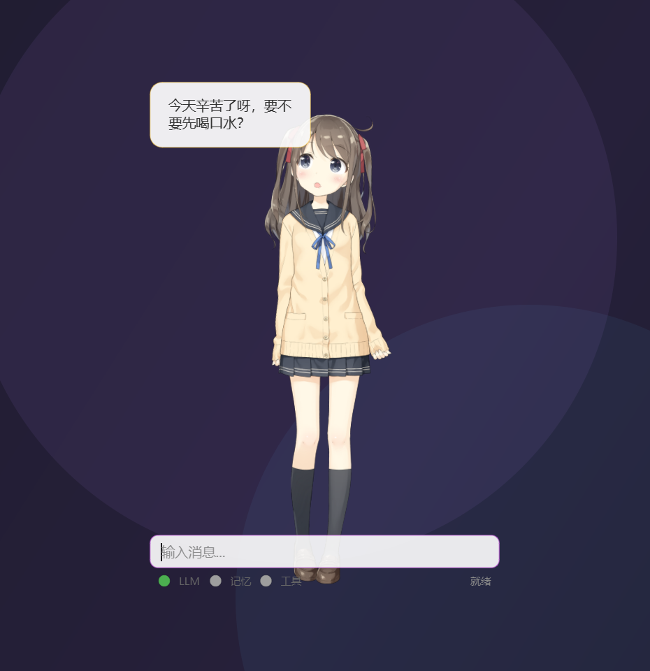
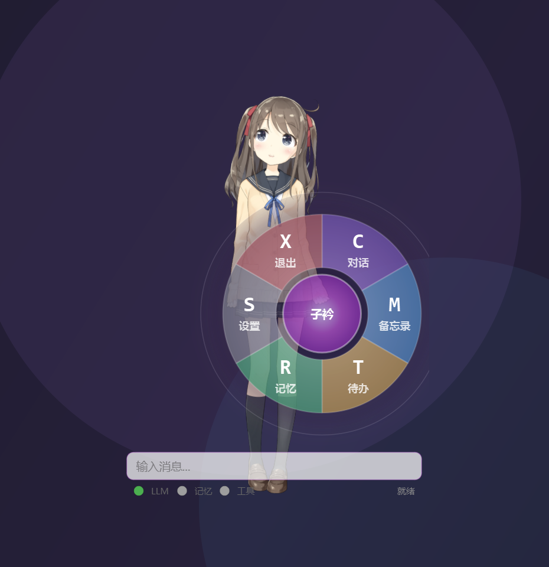

# 项目概览

> 本文档是"子衿桌面伴生代理"项目解剖系列的第一部分，面向中级开发者的全景扫描。

## 1. 项目定位

**子衿**（`ZiJin`）是一个**桌面伴生代理（Desktop Companion Agent）**，基于 **PyQt6 + Live2D** 构建。

一句话描述：让一个名为"子衿"（取自《诗经》"青青子衿，悠悠我心"）的虚拟角色常驻桌面，陪用户聊天、记忆、执行桌面小工具操作，并通过 Live2D 角色动画表达情感。

- 项目类型：**桌面 GUI 应用**（非 Web、非 CLI、非库）
- 数据来源：[README.md](file:///e:/Projects0/Agent/ZiJin/README.md#L5) `一个基于 PyQt6 + Live2D 的桌面虚拟伴侣`

### 界面预览

<p align="center">
  
  &nbsp;
  
</p>

<p align="center"><sub>左：对话与情感驱动表情　右：右键唤出的圆环菜单</sub></p>

> 截图为实机渲染；对话文案为演示内容，实际回复由所接入的模型生成。

### 核心能力一览

| 能力 | 说明 | 证据 |
|------|------|------|
| LLM 对话 | 支持 Ollama（本地）与 OpenAI API（云端）双后端 | [core/llm.py](file:///e:/Projects0/Agent/ZiJin/core/llm.py#L30-L50) |
| 情感系统 | 10 种情感标签，驱动 Live2D 表情与动作 | [config/settings.py](file:///e:/Projects0/Agent/ZiJin/config/settings.py#L29) |
| 三层记忆 | 短期内存 + 长期 ChromaDB 向量检索 + 用户画像 JSON | [core/memory/manager.py](file:///e:/Projects0/Agent/ZiJin/core/memory/manager.py#L30-L34) |
| 工具系统 | 装饰器注册 + LLM Function Calling，安全分级 | [tools/registry.py](file:///e:/Projects0/Agent/ZiJin/tools/registry.py#L47-L55) |
| Live2D 角色 | 实时渲染、眼神跟随、点击互动、情感动作映射 | [ui/components/live2d_widget.py](file:///e:/Projects0/Agent/ZiJin/ui/components/live2d_widget.py) |
| 桌面工具 | 备忘录、待办、音量控制、系统信息、TTS 朗读、审计日志 | [tools/](file:///e:/Projects0/Agent/ZiJin/tools) 目录 |

## 2. 技术栈

| 层级 | 技术 | 用途 | 证据 |
|------|------|------|------|
| 语言 | Python 3.11+ | 全部代码 | [main.py](file:///e:/Projects0/Agent/ZiJin/main.py#L15) |
| GUI | PyQt6 + PyQt6-WebEngine | 主窗口、控件 | [requirements.txt](file:///e:/Projects0/Agent/ZiJin/requirements.txt#L6-L7) |
| 图形渲染 | OpenGL 3.3 + PyOpenGL | Live2D 渲染 | [main.py](file:///e:/Projects0/Agent/ZiJin/main.py#L100-L104) |
| 角色模型 | Live2D Cubism SDK（live2d 包） | 模型加载与动画 | [requirements.txt](file:///e:/Projects0/Agent/ZiJin/requirements.txt#L10) |
| LLM | Ollama / OpenAI API | 对话生成（OpenAI 走 requests 直连） | [core/llm.py](file:///e:/Projects0/Agent/ZiJin/core/llm.py#L22-L27) |
| 向量数据库 | ChromaDB | 长期记忆存储与检索 | [requirements.txt](file:///e:/Projects0/Agent/ZiJin/requirements.txt#L2) |
| 语音 | pyttsx3（Windows SAPI） | 文本朗读 TTS | [requirements.txt](file:///e:/Projects0/Agent/ZiJin/requirements.txt#L12) |
| 系统控制 | pycaw（音量）、pyautogui、psutil | 桌面工具 | [requirements.txt](file:///e:/Projects0/Agent/ZiJin/requirements.txt#L3-L13) |
| 任务调度 | schedule | 定时任务 | [requirements.txt](file:///e:/Projects0/Agent/ZiJin/requirements.txt#L4) |
| 打包 | PyInstaller | 构建可执行文件 | [build.py](file:///e:/Projects0/Agent/ZiJin/build.py#L19-L27) |
| 测试 | pytest + pytest-cov | 单元测试 | [pyproject.toml](file:///e:/Projects0/Agent/ZiJin/pyproject.toml#L1-L5) |

## 3. 目录结构解析

```
ZiJin/
├── main.py              # 程序入口：初始化配置 → Agent → PyQt6 主窗口
├── config/              # 全局配置（唯一配置中心）
│   └── settings.py      #   所有常量、环境变量、系统提示词、启动校验
├── core/                # 核心逻辑（与界面无关的纯业务层）
│   ├── agent.py         #   Agent 协调器：对话编排、工具循环、降级规则
│   ├── llm.py           #   LLM 双后端封装（Ollama/OpenAI）
│   ├── bus.py           #   事件总线（发布-订阅，模块解耦）
│   ├── emotion.py       #   情感标签提取与系统提示拼接
│   ├── chat_history.py  #   会话记录（纯内存）
│   ├── tool_executor.py #   工具调用执行器（带轮数上限）
│   ├── memory/          #   三层记忆子系统
│   │   ├── manager.py   #     统一入口（记忆管理器）
│   │   ├── short_memory.py  # 短期记忆（内存环形）
│   │   ├── long_memory.py   # 长期记忆（ChromaDB）
│   │   ├── user_profile.py  # 用户画像（JSON 持久化）
│   │   ├── importance.py    # 记忆重要性打分
│   │   └── viewer.py        # 记忆查看器（供 UI 使用）
│   ├── async_executor.py # 异步任务执行器
│   ├── rate_limit.py     # 限流
│   └── log.py            # 日志封装
├── tools/               # 工具系统（LLM Function Calling 的落地实现）
│   ├── registry.py      #   注册表：装饰器注册 + 安全分级 + 生成 LLM 定义
│   ├── clock.py         #   时间/日期
│   ├── memo.py          #   备忘录
│   ├── todo.py          #   待办清单
│   ├── volume.py        #   音量控制
│   ├── tts.py           #   文本朗读
│   ├── pc_manager.py    #   系统信息/控制
│   ├── safety.py        #   安全校验
│   └── audit.py         #   审计日志
├── ui/                  # 界面层（PyQt6，依赖 core 层）
│   ├── main_window.py   #   主窗口（350×500 半透明悬浮窗）
│   ├── components/      #   基础控件：live2d_widget / chat_bubble / radial_menu / status_bar
│   ├── widgets/         #   功能面板：memo / todo / memory / settings / audit
│   └── workers/         #   后台线程：llm_worker（避免阻塞 UI）
├── models/              # Live2D 模型资源（Hiyori 角色）
├── tests/               # pytest 单元测试（8 个测试文件）
├── docs/                # 开发文档
├── data/                # 运行时数据（ChromaDB、user_profile.json、memo.json，gitignore）
├── build.py             # 打包脚本（PyInstaller）
├── ZiJin.spec           # PyInstaller 规格文件
├── version.py           # 版本号（当前 0.1.0）
├── pyproject.toml       # pytest 配置
└── requirements.txt     # 依赖清单
```

> 依据：[main.py](file:///e:/Projects0/Agent/ZiJin/main.py)、目录实际结构与 [README.md](file:///e:/Projects0/Agent/ZiJin/README.md#L58-L84)

**代码规模**：57 个 Python 文件，约 198 KB 源码。最大的文件是 [live2d_widget.py](file:///e:/Projects0/Agent/ZiJin/ui/components/live2d_widget.py)（439 行）和 [main_window.py](file:///e:/Projects0/Agent/ZiJin/ui/main_window.py)（432 行），规模适中，适合作为学习项目。

## 4. 程序入口

### 主入口：[main.py](file:///e:/Projects0/Agent/ZiJin/main.py#L90-L130)

启动顺序（`main()`）：

1. 配置校验：`validate()` 检查 LLM_PROVIDER 合法性、OpenAI 密钥、记忆轮数（[main.py#L26-L27](file:///e:/Projects0/Agent/ZiJin/main.py#L26-L27)，实现见 [config/settings.py#L131-L141](file:///e:/Projects0/Agent/ZiJin/config/settings.py#L131-L141)）
2. Windows DPI 感知设置（高分屏适配，[main.py#L30-L36](file:///e:/Projects0/Agent/ZiJin/main.py#L30-L36)）
3. 初始化日志与全局异常捕获（[main.py#L38-L48](file:///e:/Projects0/Agent/ZiJin/main.py#L38-L48)）
4. 创建 `Agent()` 协调器（LLM + 记忆 + 工具执行器）
5. 创建 PyQt6 `QApplication`，设置 OpenGL 3.3 渲染格式
6. 定位 Live2D 模型文件（缺失则警告降级）
7. 创建并显示 `MainWindow(agent, model_path)`，居中到屏幕
8. 进入 Qt 事件循环 `app.exec()`

### 其他入口点

| 文件 | 作用 |
|------|------|
| [build.py](file:///e:/Projects0/Agent/ZiJin/build.py) | `python build.py` 调 PyInstaller 打包 |
| [tests/](file:///e:/Projects0/Agent/ZiJin/tests) | `pytest` 直接运行全部单元测试 |

## 5. 核心配置项

所有配置集中在 [config/settings.py](file:///e:/Projects0/Agent/ZiJin/config/settings.py)，支持**环境变量覆盖**（通过 `_env()` 读取，[settings.py#L5-L6](file:///e:/Projects0/Agent/ZiJin/config/settings.py#L5-L6)）。

### 关键配置分组

| 分组 | 配置项 | 默认值 | 说明 |
|------|--------|--------|------|
| LLM | `LLM_PROVIDER` | `ollama` | `ollama` 或 `openai_api` |
| | `OLLAMA_BASE_URL` / `OLLAMA_MODEL` | `http://localhost:11434` / `qwen2.5:7b-instruct` | 本地模型 |
| | `OPENAI_API_KEY` / `OPENAI_BASE_URL` / `OPENAI_MODEL` | 空 / `https://api.openai.com/v1` / `gpt-4o-mini` | 云端模型 |
| 记忆 | `SHORT_MEMORY_ROUNDS` | `10` | 短期记忆保留轮数 |
| | `CHROMA_DB_PATH` | `data/chroma_db` | 长期记忆存储路径 |
| | `USER_PROFILE_PATH` | `data/user_profile.json` | 用户画像 |
| Live2D | `MODEL_PATH` | `models/Hiyori.model3.json` | 模型文件 |
| | `LIVE2D_EYE_TRACKING` 等 7 项 | `True` | 交互开关（眼神/点击/待机/口型） |
| | `EMOTION_MOTIONS` | 映射表 | 情感 → Live2D 动作名（[settings.py#L45-L56](file:///e:/Projects0/Agent/ZiJin/config/settings.py#L45-L56)） |
| UI | `WINDOW_WIDTH/HEIGHT` | 350×500 | 悬浮窗尺寸 |
| | `WINDOW_POSITION` | `bottom_right` | 贴边吸附位置 |
| 语音 | `TTS_ENABLED/RATE/VOLUME/VOICE_INDEX` | 开启 / 150 / 0.9 / 0 | TTS 参数 |
| 工具 | `TOOLS_ENABLED` 及 memo/todo/volume 开关 | `True` | 功能开关 |

### 最核心的一项：`SYSTEM_PROMPT`（系统提示词）

[config/settings.py#L85-L128](file:///e:/Projects0/Agent/ZiJin/config/settings.py#L85-L128) 定义的角色人格，其中包含对 LLM 的硬性约束：

- 必须用工具回答时间/音量/备忘/待办等问题（**禁止编造**）
- 每条回复必须以 `[情感标签]` 开头（10 选 1）
- 回复保持简洁温暖（30 字以内）

这条提示词是**情感系统与工具系统能否正常工作的前提**，二次开发时如果改了回复格式，必须同步改 [core/emotion.py](file:///e:/Projects0/Agent/ZiJin/core/emotion.py) 中的解析逻辑。

## 6. 一次典型启动的关键日志

```
=== 子衿桌面伴生代理 启动中 ===
Agent就绪: qwen2.5:7b-instruct
已注册工具: [...]
子衿已上线
```

## 7. 已有文档索引

`docs/` 目录当前包含：本解剖系列（1/2/3）+ 项目自带保留文档（00/07/10/api）。历史编号文档（01~06/08/09）因与代码脱节已删除，内容由本系列与 [DEVELOPER.md](../../DEVELOPER.md) 覆盖。

- [docs/00-overview.md](file:///e:/Projects0/Agent/ZiJin/docs/00-overview.md) → 项目总览（对应本文）
- [docs/07-live2d.md](file:///e:/Projects0/Agent/ZiJin/docs/07-live2d.md) → Live2D 交互
- [docs/10-audit.md](file:///e:/Projects0/Agent/ZiJin/docs/10-audit.md) → 审计日志
- [docs/api.md](file:///e:/Projects0/Agent/ZiJin/docs/api.md) → API 参考（工具清单最全）
