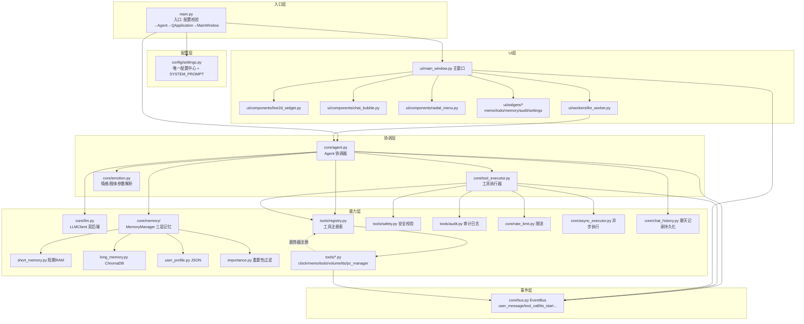

# 架构与模块详解

> 本文档是"子衿桌面伴生代理"项目解剖系列的第二部分。所有结论均标注源码依据。

## 1. 架构风格判定

子衿采用**分层架构 + 事件驱动 + 协调器模式**，辅以**装饰器扩展机制**。具体体现：

| 特征 | 表现 | 证据 |
|------|------|------|
| 分层架构 | UI 层(`ui/`) → 协调层(`core/agent.py`) → 能力层(`core/llm`、`core/memory`、`tools/`) | 目录结构见 [Phase 1](1-项目概览.md) |
| 事件驱动 | `core/bus.py` 的 `EventBus` 实现发布-订阅，UI 与 Agent、TTS 与 Live2D 之间通过事件解耦 | [core/bus.py](file:///e:/Projects0/Agent/ZiJin/core/bus.py#L20-L59) |
| 协调器模式 | `Agent` 是唯一编排者：接收输入、拼上下文、调 LLM、驱动工具循环 | [core/agent.py](file:///e:/Projects0/Agent/ZiJin/core/agent.py#L54-L65) |
| 装饰器扩展 | 工具系统通过 `@registry.register(...)` 装饰器注册，LLM 无需知道具体实现 | [tools/registry.py](file:///e:/Projects0/Agent/ZiJin/tools/registry.py#L61-L97) |
| 多线程 | UI 线程不阻塞：`LLMWorker` 后台线程 + 50ms `QTimer` 轮询；耗时工具走 `AsyncExecutor` | [ui/workers/llm_worker.py](file:///e:/Projects0/Agent/ZiJin/ui/workers/llm_worker.py#L20-L39)、[ui/main_window.py](file:///e:/Projects0/Agent/ZiJin/ui/main_window.py#L254-L282) |

### 数据流全景

```
用户输入
   │
   ▼
┌────────────────────────────────────────────────────────────┐
│ UI 层 (ui/)                                                 │
│  MainWindow.on_user_input() → LLMWorker(后台线程)           │
│  线程结果经 queue 放入，主线程 50ms QTimer 轮询读取          │
└────────────────────────┬───────────────────────────────────┘
                         │ chat_stream()
                         ▼
┌────────────────────────────────────────────────────────────┐
│ 协调层 core/agent.py  Agent                                 │
│  1. 记忆记录 user 消息（短期/长期/用户画像）                 │
│  2. build_context() 组装上下文                              │
│  3. 循环 ≤3 轮(MAX_TOOL_ROUNDS)：LLM 生成 → 有工具调用?     │
│        ├─ 是 → ToolExecutor.execute_calls()                 │
│        │        → 限流→确认→安全校验→(同步/异步)执行→审计   │
│        └─ 否 → 尝试 FALLBACK_RULES 正则兜底                 │
│  4. extract_emotion() 提取情感+肢体参数                      │
│  5. 记忆记录 assistant 消息                                  │
└───────┬────────────────────────────┬───────────────────────┘
        │ yield {type:text/emotion}  │ bus.emit 事件
        ▼                            ▼
┌───────────────────┐   ┌──────────────────────────┐
│ Live2DWidget      │   │ 审计/日志/其他订阅者       │
│ play_emotion()    │   │ tools/audit.py 写 JSONL   │
│ set_parameter()   │   │ core/log.py 输出日志       │
└───────────────────┘   └──────────────────────────┘
```

## 2. 模块依赖图



### 依赖方向说明

- **core 层不依赖 ui 层**（纯业务逻辑），ui 层单向依赖 core 层 —— 这是本架构最值得学习的一点。
- **tools 层**依赖 `registry` 注册工具，自身不关心 LLM 如何调用它们。
- **事件总线 BUS** 是旁路通道：不改变主流程，只用于 UI 通知、日志与 TTS/Live2D 联动。

## 3. 核心数据模型

### 3.1 对话消息（LLM 标准格式）

全项目统一使用 OpenAI 兼容的 messages 格式，`Agent` 组装、`LLMClient` 透传：

```python
{"role": "user" | "assistant" | "system" | "tool",
 "content": "文本",
 "tool_calls": [...]}   # 仅 assistant 消息可能携带
```

证据：[core/llm.py](file:///e:/Projects0/Agent/ZiJin/core/llm.py#L100-L117) 直接透传给 ollama/OpenAI，未做任何二次封装。

### 3.2 工具定义（ToolDef）

| 字段 | 类型 | 说明 |
|------|------|------|
| `name` | str | LLM 调用时使用的工具名 |
| `description` | str | LLM 判断何时使用的依据 |
| `func` | Callable | 实际执行函数 |
| `parameters` | dict | JSON Schema 参数定义 |
| `safety_level` | str | `safe`/`moderate`/`dangerous` |
| `required_confirm` | bool | 是否需用户确认 |

证据：[tools/registry.py](file:///e:/Projects0/Agent/ZiJin/tools/registry.py#L26-L44)

### 3.3 工具调用与结果（Agent↔LLM 协议）

```
LLM 产出: {"id": "call_xxx", "type": "function",
            "function": {"name": "set_volume", "arguments": "{\"level\": 50}"}}
         ↓ 工具执行器解析
执行结果: {"name": "set_volume", "arguments": {...}, "result": "音量已调到50"}
         ↓ 回填为 role="tool" 消息给 LLM
```

证据：[core/tool_executor.py](file:///e:/Projects0/Agent/ZiJin/core/tool_executor.py#L21-L47)

### 3.4 Agent 返回结构

| 字段 | 说明 |
|------|------|
| `emotion` | 10 种情感标签之一 |
| `text` | 去标签后的纯净回复 |
| `body_params` | 肢体语言参数字典（驱动 Live2D 表情） |
| `tool_calls` / `tool_results` | 本轮实际执行过的工具 |

证据：[core/agent.py](file:///e:/Projects0/Agent/ZiJin/core/agent.py#L209-L221)

### 3.5 情感与肢体参数体系

```
情感标签(10种): happy / sad / angry / surprised / neutral / thinking / shy / excited / gentle / melancholy
LLM 输出格式:   [happy,body:head_tilt=8] 太好了！
                 │      │            │
                 │      │            └─ 肢体参数值(可浮点)
                 │      └─ body 前缀可选，参数名映射 Live2D 参数 ID
                 └─ 情感标签
解析结果:       ("happy", "太好了！", {"head_tilt": 8})
```

参数映射表：[core/emotion.py](file:///e:/Projects0/Agent/ZiJin/core/emotion.py#L18-L25)

| 简化名 | Live2D 参数 ID | 含义 |
|--------|----------------|------|
| `head_tilt` | ParamAngleZ | 头部倾斜 |
| `head_turn` | ParamAngleX | 头部左右 |
| `body_lean` | ParamBodyAngleZ | 身体倾斜 |
| `body_turn` | ParamBodyAngleX | 身体左右 |
| `eye_open` | ParamEyeLOpen | 眼睛开合 |
| `mouth` | ParamMouthOpenY | 嘴巴开合 |

### 3.6 三层记忆模型

| 层 | 存储介质 | 生命周期 | 数据结构 | 证据 |
|----|----------|----------|----------|------|
| 短期记忆 | 内存列表 | 进程内，重启清空 | `{"role", "content", "timestamp"}`，上限 `max_rounds*2` 条 | [short_memory.py](file:///e:/Projects0/Agent/ZiJin/core/memory/short_memory.py#L26-L33) |
| 长期记忆 | ChromaDB（HNSW 余弦） | 持久化 | document + metadata(`type/importance/timestamp/text_length`) | [long_memory.py](file:///e:/Projects0/Agent/ZiJin/core/memory/long_memory.py#L89-L124) |
| 用户画像 | JSON 文件 | 持久化 | `{name, preferences{}, facts[], created_at}` | [user_profile.py](file:///e:/Projects0/Agent/ZiJin/core/memory/user_profile.py#L24-L35) |

**长期记忆的"选择性入库"**：[importance.py](file:///e:/Projects0/Agent/ZiJin/core/memory/importance.py#L35-L94) 从 7 个维度打分（基础 0.5 分：长度/低价值词/高价值词/疑问句/日期数字/情感标签/角色），≥0.4 才入库（[manager.py](file:///e:/Projects0/Agent/ZiJin/core/memory/manager.py#L50-L67)），并有 0.95 相似度去重（[long_memory.py#L69-L87](file:///e:/Projects0/Agent/ZiJin/core/memory/long_memory.py#L69-L87)）。

### 3.7 审计记录（JSONL）

```json
{"ts": "2026-07-04T13:28:16.123456", "tool": "set_volume", "args": {"level": 50},
 "result": "音量已调节至 50", "level": "moderate", "blocked": false, "error": ""}
```

证据：[tools/audit.py](file:///e:/Projects0/Agent/ZiJin/tools/audit.py#L20-L34)，超 10MB 自动轮转（[audit.py#L36-L39](file:///e:/Projects0/Agent/ZiJin/tools/audit.py#L36-L39)）。

### 3.8 事件总线事件清单

| 事件 | 发射方 | 订阅方 | 作用 |
|------|--------|--------|------|
| `user_message` | Agent | —（预留） | 用户输入通知 |
| `tool_call` / `tool_result` | ToolExecutor | —（预留） | 工具调用追踪 |
| `tts_start` / `tts_end` | TTS 工具 | MainWindow | 驱动 Live2D 口型同步 |

证据：[core/bus.py](file:///e:/Projects0/Agent/ZiJin/core/bus.py#L35-L44)、[ui/main_window.py](file:///e:/Projects0/Agent/ZiJin/ui/main_window.py#L104-L106)

## 4. 典型业务流程追踪

以用户输入 **"现在几点了？"** 为例，完整走一遍（含兜底分支）：

### 第 1 步：UI 接收与线程调度

用户在输入框回车 → `MainWindow._on_send()` → `on_user_input(text)`：
- 显示打字中气泡、状态栏"思考中"
- 创建 `LLMWorker(agent, text, use_stream=True)` 并 `start()`（后台线程，[llm_worker.py#L20-L39](file:///e:/Projects0/Agent/ZiJin/ui/workers/llm_worker.py#L20-L39)）
- 启动 50ms `QTimer` 轮询线程队列（[main_window.py#L254-L282](file:///e:/Projects0/Agent/ZiJin/ui/main_window.py#L254-L282)）

### 第 2 步：Agent 记忆录入

`agent.chat_stream("现在几点了？")`（[agent.py#L117-L199](file:///e:/Projects0/Agent/ZiJin/core/agent.py#L117-L199)）：
- `memory.add_conversation("user", ...)`：写入短期；importance 打分（含"几"字命中间题模式 +0.15，约 0.45 ≥ 0.4）→ 写入长期
- `chat_history.add_message("user", ...)` 持久化

### 第 3 步：上下文构建

`memory.build_context(query)`（[manager.py#L69-L107](file:///e:/Projects0/Agent/ZiJin/core/memory/manager.py#L69-L107)）拼出三段式：
1. `[用户信息]` 画像段（system）
2. `[相关记忆]` 向量检索 top3（system）
3. 短期记忆最近 20 条消息

### 第 4 步：LLM 生成与工具循环

`for round_i in range(MAX_TOOL_ROUNDS=3)`：
- 流式调用 LLM 产出文本 chunk 逐段 `yield {type:"text"}`
- 流结束后**再同步调用一次** `llm.chat()` 获取完整的 `tool_calls`（[agent.py#L158-L163](file:///e:/Projects0/Agent/ZiJin/core/agent.py#L158-L163)）
- 若 LLM 决定调用 `get_current_time` 工具 → `tool_executor.execute_calls()` → 每个工具依次过五关：

```
限流 check ──> 需确认? ──> 安全校验 ──> 同步 or 异步执行 ──> 审计落盘
(tools/audit.py 与 rate_limit 都在 tool_executor 内串联)
```

### 第 5 步：规则兜底（本场景常见分支）

若本地小模型（如 qwen2.5:7b）没触发 function calling，`_try_fallback()` 用正则兜底：`r"几点"` 命中 → 直接 `registry.execute("get_current_time")`（[agent.py#L223-L249](file:///e:/Projects0/Agent/ZiJin/core/agent.py#L223-L249)、[clock.py](file:///e:/Projects0/Agent/ZiJin/tools/clock.py#L11-L14)）。

兜底规则表：[agent.py#L25-L51](file:///e:/Projects0/Agent/ZiJin/core/agent.py#L25-L51)（时间/日期/音量查询/音量设置/静音 5 类）。

### 第 6 步：情感提取与回写

`extract_emotion("[gentle] 现在是...")` → `("gentle", "现在是...", {})` → 记忆回写 assistant 消息 → `yield {type:"emotion"}, {type:"done"}`

### 第 7 步：UI 渲染

主线程 `_handle_chunk` 收到 emotion → `live2d.play_emotion("gentle")`（映射到 Idle 动画）+ 气泡显示文本（[main_window.py#L304-L326](file:///e:/Projects0/Agent/ZiJin/ui/main_window.py#L304-L326)）。

## 5. 模块职责速查

| 模块 | 一句话职责 | 关键文件 |
|------|-----------|----------|
| config | 唯一配置源 + 人格提示词 | settings.py |
| core.agent | 对话编排/工具循环/兜底规则 | agent.py |
| core.llm | 屏蔽双后端差异的 LLM 门面 | llm.py |
| core.memory | 三层记忆统一入口 | memory/manager.py |
| core.emotion | `[情感,body:x=y]` 协议解析 | emotion.py |
| core.tool_executor | 工具调用五关流水线 | tool_executor.py |
| core.bus | 进程内发布-订阅 | bus.py |
| core.chat_history | 聊天记录持久化(JSON) | chat_history.py |
| core.rate_limit | 工具调用频率限制 | rate_limit.py |
| core.async_executor | 耗时工具异步执行 | async_executor.py |
| tools.registry | 工具注册表+LLM定义生成 | registry.py |
| tools.* | 具体工具实现（纯函数） | clock/memo/todo/... |
| tools.safety | 危险输入校验 | safety.py |
| tools.audit | JSONL 审计+轮转 | audit.py |
| ui.main_window | 主窗口/托盘/事件分发 | main_window.py |
| ui.components | Live2D/气泡/圆环菜单等控件 | components/ |
| ui.widgets | 各功能面板 | widgets/ |
| ui.workers | LLM 后台线程 | workers/llm_worker.py |
